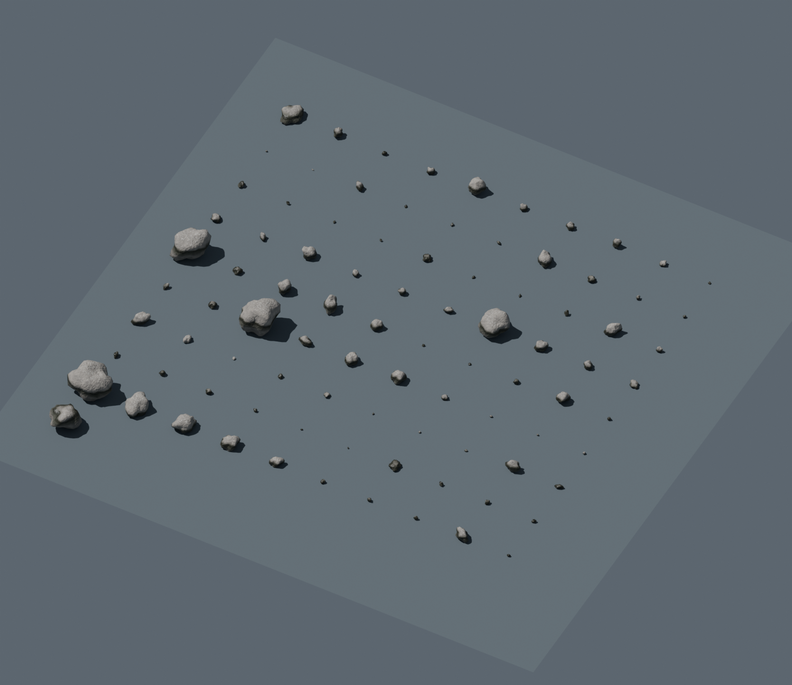

# 石头模型（Blender / Unreal Engine）

[下载完整模型包](https://github.com/Alano-ai/Ultra-Water/releases/download/rocks-v1.0.0/UltraWater_Rocks_Blender_UE.zip) · [详细使用说明](使用说明.txt) · [验证报告](validation.json)

模型直接提取自项目的 `createTerrain()`：90 块岸边及伴生石，加 1 块拍岸大礁石。原项目共用同一源网格，通过不同缩放和旋转产生实例；导出后 91 块石头均可独立编辑，每块保留 252 个顶点、500 个三角面。



## 文件内容

| 文件 | 用途 |
| --- | --- |
| `UltraWater_Rocks.blend` | 可编辑网格、原始布局、排列预览场景，以及地形参考场景；贴图已内嵌 |
| `fbx_individual/` | 91 个独立静态网格，旋转和尺寸烘焙进顶点，枢轴在底面中心 |
| `Rocks_OriginalLayout.fbx` | 原始布局，适合通过 UE 的 Import Into Level 恢复场景 |
| `Rocks_OriginalLayout.glb` | 内嵌通用 PBR 材质的交换格式 |
| `textures/` | 共享 4K Base Color、Roughness，以及 OpenGL / DirectX 法线贴图 |
| `reference/Island_Terrain_Reference.fbx` | 含岩石山脊的完整岛屿网格，仅参考纯色材质 |
| `Import_Into_UE.py` | 可选的 UE5 批量导入、材质连接与自动碰撞脚本 |

在 Blender 中直接打开 `.blend`，选中石头后按 Tab 编辑。Blender 和 GLB 使用 OpenGL 法线；UE 手动材质使用 `T_Rock_Normal_DirectX.png`。UV0 用于共享材质图集，UV1 为每块网格的光照展开。完整操作见[使用说明](使用说明.txt)。

## 重新导出

需要 Node.js、项目依赖，以及可从命令行运行的 Blender。当前导出和验证使用 Blender 5.2.3 LTS。

```bash
npm ci
node tools/export_rocks.mjs
blender -b --factory-startup --python-exit-code 1 --python tools/verify_rock_exports.py -- exports/rocks
```

生成的模型和贴图位于 `exports/rocks/`，该目录不进入 Git 历史。发布包作为 GitHub Release 附件提供。

## 验证与限制

已回读 `.blend`、布局 FBX、全部 91 个独立 FBX、GLB 和参考地形，并检查原始尺寸、位置、网格完整性、UV、顶点色和贴图引用。共 45,500 个石头三角面，未发现非流形边。详情见[验证报告](validation.json)和[实例清单](manifest.json)。

静态颜色、潮间带色带和粗糙度按原网页公式采样；程序化凹凸转换为切线空间法线近似。动态湿润、浪花、水下吸收、焦散及网页光照和雾需要在目标引擎中实现。参考地形不包含网页的生物群系材质。UE 编辑器和可选的 UE Python 脚本尚未实跑验证。

模型沿用项目 MIT 许可证；分发时保留包内的 `LICENSE`、`THIRD_PARTY_NOTICES.md` 和 `THREE-LICENSE.txt`。
